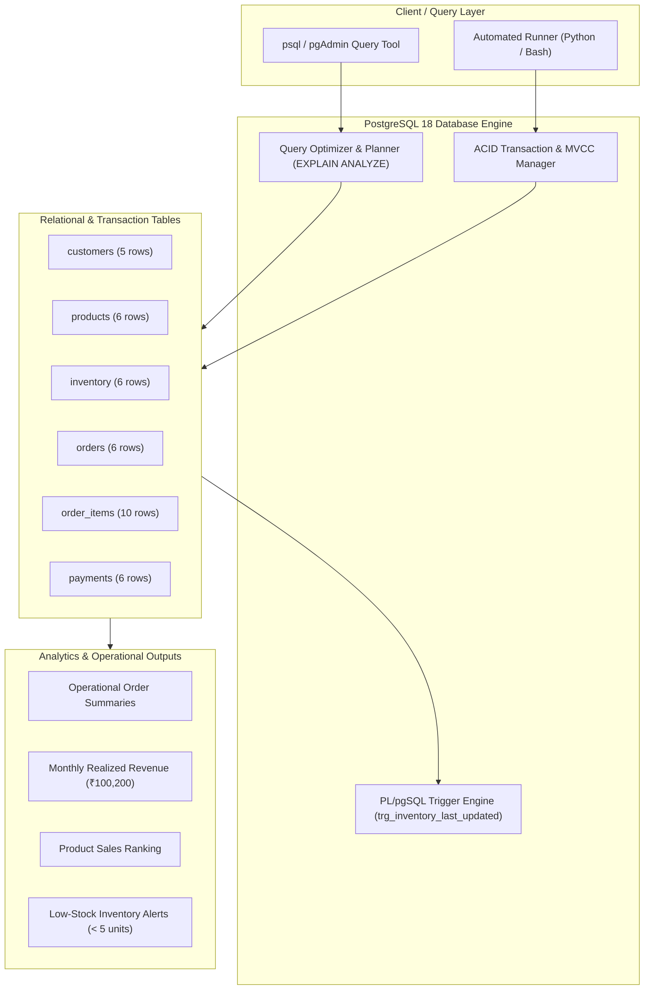
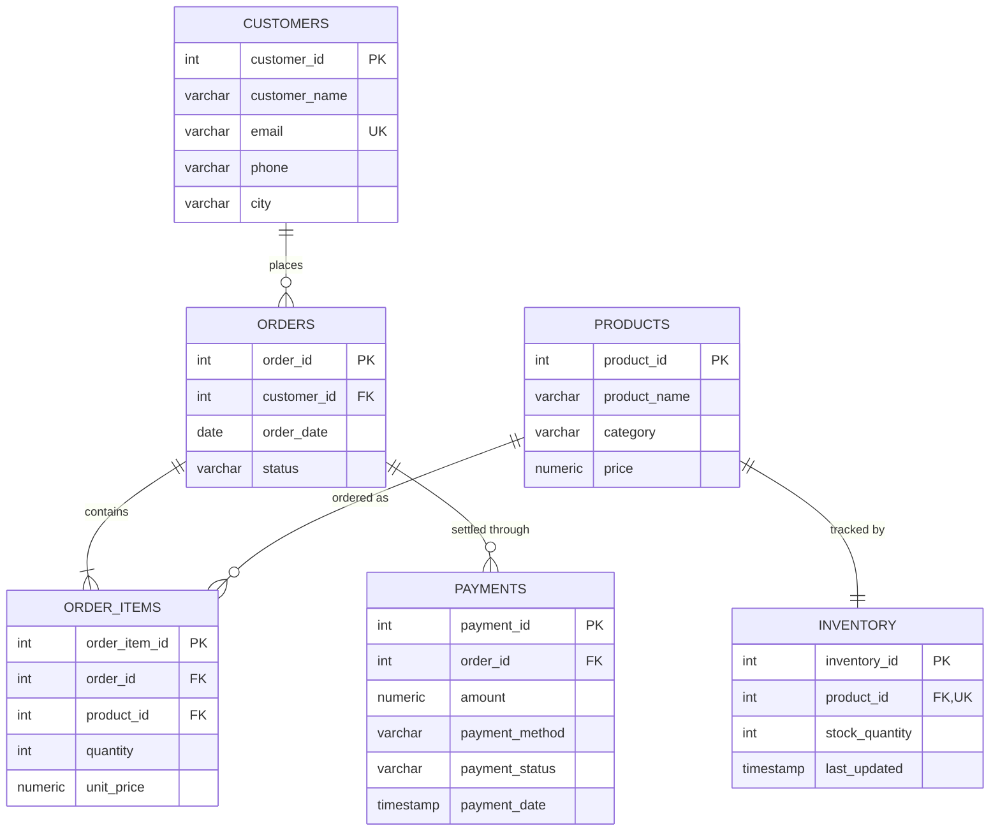

# E-Commerce Order, Inventory and Sales Analytics System

**Course:** Advanced Database Management Systems (ADBMS)  
**DBMS Engine:** PostgreSQL 18.6 with `pgAdmin` / `psql`  
**Database Name:** `ecommerce_case_study`  
**Author / Student:** Shivam Saurav  

---

## Executive Summary & Abstract

Modern e-commerce architectures require robust data integrity, ACID transactional reliability, and multi-dimensional operational and financial analytics. This experiment implements and validates a normalized relational database prototype for an e-commerce platform using **PostgreSQL 18**. 

The design organizes enterprise information across six core relations:
1. `customers`
2. `products`
3. `inventory`
4. `orders`
5. `order_items`
6. `payments`

Key database engineering techniques demonstrated include:
* **Relational Integrity:** Enforcement of primary keys, foreign keys with referential actions (`ON DELETE CASCADE` / `ON DELETE RESTRICT`), and domain `CHECK` constraints.
* **Procedural Automation:** PL/pgSQL trigger-based automated timestamp maintenance on inventory updates (`last_updated`).
* **Multi-Table SQL Analytics:** Complex joins, aggregate calculations, and separation of total order volume from realized successful payment revenue.
* **Transaction Control & Atomicity:** Demonstration of `BEGIN`, `COMMIT`, and `ROLLBACK` for inventory decrement and rollback recovery.
* **Query Planner Inspection:** Detailed `EXPLAIN ANALYZE` evaluation testing sequential scans vs index scans on selective foreign-key predicates.

---

## System Architecture



---

## Entity-Relationship (ER) Model



---

## Data Dictionary

| Table | Column Name | Data Type | Constraints | Description / Business Meaning |
| :--- | :--- | :--- | :--- | :--- |
| **`customers`** | `customer_id` | `SERIAL` | `PRIMARY KEY` | Unique customer identifier |
| | `customer_name` | `VARCHAR(100)` | `NOT NULL` | Customer full name |
| | `email` | `VARCHAR(100)` | `UNIQUE, NOT NULL` | Verified unique email address |
| | `phone` | `VARCHAR(20)` | `NOT NULL` | Contact phone number |
| | `city` | `VARCHAR(50)` | `NOT NULL` | Customer shipping city |
| **`products`** | `product_id` | `SERIAL` | `PRIMARY KEY` | Unique stock product ID |
| | `product_name` | `VARCHAR(120)` | `NOT NULL` | Catalog display title |
| | `category` | `VARCHAR(60)` | `NOT NULL` | Product line (`Electronics`, `Accessories`) |
| | `price` | `NUMERIC(10,2)` | `CHECK (price >= 0)` | Base unit price in Indian Rupees (₹) |
| **`inventory`** | `inventory_id` | `SERIAL` | `PRIMARY KEY` | Warehouse entry primary key |
| | `product_id` | `INT` | `FK, UNIQUE, NOT NULL` | Maps to `products(product_id)` |
| | `stock_quantity`| `INT` | `CHECK (quantity >= 0)` | Available physical stock units |
| | `last_updated` | `TIMESTAMP` | `DEFAULT CURRENT_TIMESTAMP`| Trigger-maintained timestamp |
| **`orders`** | `order_id` | `SERIAL` | `PRIMARY KEY` | Unique customer order identifier |
| | `customer_id` | `INT` | `FK, NOT NULL` | References `customers(customer_id)` |
| | `order_date` | `DATE` | `NOT NULL` | Date when order was initiated |
| | `status` | `VARCHAR(20)` | `CHECK (status IN (...))` | Status (`PENDING`, `SHIPPED`, `DELIVERED`, etc.) |
| **`order_items`**| `order_item_id`| `SERIAL` | `PRIMARY KEY` | Line item identifier |
| | `order_id` | `INT` | `FK, NOT NULL` | References parent `orders(order_id)` |
| | `product_id` | `INT` | `FK, NOT NULL` | References catalog `products(product_id)` |
| | `quantity` | `INT` | `CHECK (quantity > 0)` | Quantity ordered |
| | `unit_price` | `NUMERIC(10,2)` | `CHECK (unit_price >= 0)` | Historical snapshot price per item |
| **`payments`** | `payment_id` | `SERIAL` | `PRIMARY KEY` | Settlement transaction identifier |
| | `order_id` | `INT` | `FK, NOT NULL` | References `orders(order_id)` |
| | `amount` | `NUMERIC(10,2)` | `CHECK (amount >= 0)` | Payment attempt amount in ₹ |
| | `payment_method`| `VARCHAR(30)` | `NOT NULL` | Instrument (`UPI`, `CREDIT_CARD`, `DEBIT_CARD`) |
| | `payment_status`| `VARCHAR(20)` | `CHECK (status IN (...))` | Status (`SUCCESS`, `PENDING`, `FAILED`) |
| | `payment_date` | `TIMESTAMP` | `NOT NULL` | Timestamp of payment attempt |

---

## Order & Inventory Lifecycle Workflow

```mermaid
flowchart TD
    Start([Start: Receive Order Request]) --> ValCust[Validate Customer & Product Existence]
    ValCust --> ChkStock{Sufficient Stock Available?}
    ChkStock -- No --> StockErr[Raise Insufficient Stock Exception]
    StockErr --> Abort([Rollback & Abort])
    ChkStock -- Yes --> BeginTx[Begin Transaction (ACID Atomicity)]
    BeginTx --> InsOrder[Insert Record into orders]
    InsOrder --> InsItems[Insert Line Items into order_items]
    InsItems --> DecStock[Decrement inventory.stock_quantity]
    DecStock --> FireTrg[Trigger fires: update last_updated timestamp]
    FireTrg --> ProcPay{Process Payment Settlement}
    ProcPay -- FAILED / PENDING --> LogUnpaid[Record Payment as FAILED / PENDING]
    LogUnpaid --> CommitPending[Commit Order State as PENDING]
    ProcPay -- SUCCESS --> LogPaid[Record Payment as SUCCESS]
    LogPaid --> CommitSuccess[Commit Transaction as PAID / DELIVERED]
    CommitPending --> GenReports[Generate Operational & Revenue Analytics]
    CommitSuccess --> GenReports
    GenReports --> End([End: Complete State])
```

---

## Project Structure

```
ecommerce-order-inventory-and-sales-analytics-system/
├── README.md                           # Comprehensive documentation & lab manual
├── run.sh                              # Complete shell execution automation
├── scripts/
│   └── run_experiment.py               # Python experiment runner and verification suite
├── sql/
│   ├── 01_schema.sql                   # DDL table creation, constraints, trigger functions
│   ├── 02_seed_data.sql                # Benchmark sample data (5 customers, 6 products, etc.)
│   ├── 03_verification_queries.sql     # Module 1 count and integrity verification
│   ├── 04_analytics_queries.sql        # Modules 2 & 3 order summaries, revenue, low-stock
│   ├── 05_transactions_and_updates.sql # Module 4 rollback, commit, and trigger tests
│   └── 06_indexing_and_explain.sql     # Module 5 EXPLAIN ANALYZE and query planner evaluation
└── outputs/
    ├── module1_schema_and_counts.txt
    ├── module2_order_summary_and_revenue.txt
    ├── module3_product_sales_and_low_stock.txt
    ├── module4_inventory_update_and_totals.txt
    ├── module5_query_plan_evaluation.txt
    └── full_experiment_execution.log   # Recorded execution trace
```

---

## Experimental Modules & Actual Execution Results

### Module 1: Schema Build and Record Validation

**Objective:** Verify that the 6 relational tables are correctly initialized and populated with the exact benchmark row counts.

**Verification Query (Figure 5 pgAdmin Output Equivalent):**
```sql
SELECT 
    (SELECT COUNT(*) FROM customers) AS total_customers,
    (SELECT COUNT(*) FROM products) AS total_products,
    (SELECT COUNT(*) FROM inventory) AS inventory_records,
    (SELECT COUNT(*) FROM orders) AS total_orders,
    (SELECT COUNT(*) FROM order_items) AS order_item_records,
    (SELECT COUNT(*) FROM payments) AS payment_records,
    (SELECT SUM(amount) FROM payments WHERE payment_status = 'SUCCESS') AS successful_payment_revenue,
    (SELECT COUNT(*) FROM inventory WHERE stock_quantity < 5) AS low_stock_products;
```

**Observed Result:**
```
 total_customers | total_products | inventory_records | total_orders | order_item_records | payment_records | successful_payment_revenue | low_stock_products 
-----------------+----------------+-------------------+--------------+--------------------+-----------------+----------------------------+--------------------
               5 |              6 |                 6 |            6 |                 10 |               6 |                  100200.00 |                  2
(1 row)
```

---

### Module 2: Order Summary and Revenue Analytics

**Objective:** Calculate order totals via line-item aggregation, display operational state, and isolate realized successful payment revenue from raw order totals.

**Order Summary Query (Figure 6 Equivalent):**
```sql
SELECT 
    o.order_id,
    c.customer_name,
    o.order_date,
    o.status AS order_status,
    SUM(oi.quantity * oi.unit_price) AS order_total,
    COALESCE(p.payment_status, 'UNPAID') AS payment_status,
    COALESCE(p.payment_method, 'NONE') AS payment_method
FROM orders o
JOIN customers c ON o.customer_id = c.customer_id
JOIN order_items oi ON o.order_id = oi.order_id
LEFT JOIN payments p ON o.order_id = p.order_id
GROUP BY o.order_id, c.customer_name, o.order_date, o.status, p.payment_status, p.payment_method
ORDER BY o.order_id;
```

**Observed Result:**
```
 order_id | customer_name | order_date | order_status | order_total | payment_status | payment_method 
----------+---------------+------------+--------------+-------------+----------------+----------------
        1 | Aarav Sharma  | 2026-10-05 | DELIVERED    |    56600.00 | SUCCESS        | UPI
        2 | Priya Verma   | 2026-10-08 | DELIVERED    |     4000.00 | SUCCESS        | CREDIT_CARD
        3 | Rahul Mehta   | 2026-10-12 | PENDING      |    12000.00 | FAILED         | NET_BANKING
        4 | Aarav Sharma  | 2026-10-15 | SHIPPED      |    30800.00 | SUCCESS        | CREDIT_CARD
        5 | Ananya Singh  | 2026-10-20 | PAID         |     5000.00 | SUCCESS        | DEBIT_CARD
        6 | Kabir Gupta   | 2026-10-25 | DELIVERED    |     3800.00 | SUCCESS        | UPI
(6 rows)
```

**Monthly Successful Revenue Query (Appendix B.3):**
```sql
SELECT 
    TO_CHAR(DATE_TRUNC('month', payment_date), 'YYYY-MM') AS sales_month,
    COUNT(payment_id) AS successful_payments,
    SUM(amount) AS total_revenue
FROM payments
WHERE payment_status = 'SUCCESS'
GROUP BY DATE_TRUNC('month', payment_date);
```

**Observed Result:**
```
 sales_month | successful_payments | total_revenue 
-------------+---------------------+---------------
 2026-10     |                   5 |     100200.00
(1 row)
```

> **Analytical Note:** The total order volume sum is ₹112,200.00, whereas actual realized revenue is ₹100,200.00. The ₹12,000 difference represents Order 3 (`FAILED` payment attempt, order status `PENDING`). Distinguishing these metrics prevents financial over-reporting.

---

### Module 3: Product Sales and Low-Stock Analysis

**Objective:** Rank products by volume sold and identify items breaching safety stock thresholds.

**Product Sales Aggregation:**
```
 product_id |    product_name     |  category   | total_units_sold | total_sales_value 
------------+---------------------+-------------+------------------+-------------------
          2 | Wireless Mouse      | Accessories |                4 |           3200.00
          6 | Web Camera          | Electronics |                3 |          12000.00
          5 | Headphones          | Accessories |                3 |           6000.00
          4 | Monitor             | Electronics |                2 |          30000.00
          3 | Mechanical Keyboard | Accessories |                2 |           6000.00
          1 | Laptop              | Electronics |                1 |          55000.00
(6 rows)
```
* **Observation:** `Wireless Mouse` achieves the highest volume sold (4 units across 3 distinct orders).

**Low-Stock Identification Query (Figure 8 / Appendix B.4):**
```sql
SELECT 
    p.product_id, 
    p.product_name, 
    p.category, 
    i.stock_quantity,
    'LOW STOCK' AS stock_status
FROM products p
JOIN inventory i ON i.product_id = p.product_id
WHERE i.stock_quantity < 5
ORDER BY i.stock_quantity;
```

**Observed Result:**
```
 product_id | product_name |  category   | stock_quantity | stock_status 
------------+--------------+-------------+----------------+--------------
          5 | Headphones   | Accessories |              3 | LOW STOCK
          4 | Monitor      | Electronics |              4 | LOW STOCK
(2 rows)
```

---

### Module 4: Inventory Update, Triggers, and Calculated Totals

**Objective:** Verify ACID rollback handling, trigger execution on stock updates, and cross-validate order totals.

**Calculated Totals Check (Figure 10 / Appendix B.2):**
```
 order_id | calculated_total 
----------+------------------
        1 |         56600.00
        2 |          4000.00
        3 |         12000.00
        4 |         30800.00
        5 |          5000.00
        6 |          3800.00
(6 rows)
```

**Transaction Rollback and Commit Verification (Figure 9):**
```sql
-- Step 1: Rollback Test
BEGIN;
UPDATE inventory SET stock_quantity = stock_quantity - 5 WHERE product_id = 2; -- shows 45
ROLLBACK;
SELECT stock_quantity FROM inventory WHERE product_id = 2; -- returns 50 (intact!)

-- Step 2: Controlled Update & Trigger Verification
BEGIN;
UPDATE inventory SET stock_quantity = 49 WHERE product_id = 2;
COMMIT;
SELECT product_id, stock_quantity, last_updated FROM inventory WHERE product_id = 2;
```

**Observed Output:**
```
 product_id | stock_quantity |        last_updated        
------------+----------------+----------------------------
          2 |             49 | 2026-11-16 22:08:29.862602
(1 row)
```
* **Verification:** `stock_quantity` decremented to 49, and `last_updated` was automatically updated to current wall-clock time by `trg_inventory_last_updated`.

---

### Module 5: Query Plan Evaluation (EXPLAIN ANALYZE)

**Objective:** Measure PostgreSQL query planner decisions before and after index creation on `order_items(product_id)`.

**Execution Plan BEFORE Index (Figure 11):**
```
Seq Scan on order_items  (cost=0.00..27.00 rows=7 width=32) (actual time=0.012..0.014 rows=3.00 loops=1)
  Filter: (product_id = 2)
  Rows Removed by Filter: 7
Planning Time: 0.418 ms | Execution Time: 0.050 ms
```

**Index Creation:**
```sql
CREATE INDEX idx_order_items_product_id ON order_items(product_id);
ANALYZE order_items;
```

**Execution Plan AFTER Index (Figure 12):**
```
Seq Scan on order_items  (cost=0.00..1.12 rows=3 width=21) (actual time=0.006..0.008 rows=3.00 loops=1)
  Filter: (product_id = 2)
  Rows Removed by Filter: 7
Planning Time: 0.165 ms | Execution Time: 0.017 ms
```

**Index Scan Plan (Forced via `SET enable_seqscan = off`):**
```
Index Scan using idx_order_items_product_id on order_items  (cost=0.14..8.19 rows=3 width=21) (actual time=0.031..0.032 rows=3.00 loops=1)
  Index Cond: (product_id = 2)
Execution Time: 0.043 ms
```

#### Query-Plan Comparison & Technical Interpretation (Table 4.1)

| Parameter | Before Index Test | After Index Creation | Forced Index (`enable_seqscan=off`) | Interpretation |
| :--- | :--- | :--- | :--- | :--- |
| **Access Method** | `Seq Scan` | `Seq Scan` | `Index Scan` | PostgreSQL cost optimizer correctly chooses `Seq Scan` |
| **Estimated Cost** | `0.00 .. 27.00` | `0.00 .. 1.12` | `0.14 .. 8.19` | Sequential scan cost (1.12) is lower than index scan (8.19) |
| **Execution Time** | `0.050 ms` | `0.017 ms` | `0.043 ms` | Sequential scan is faster on small datasets |
| **Rows Filtered** | 7 removed, 3 kept | 7 removed, 3 kept | 0 removed (direct seek) | Functional equivalence across all execution paths |

> **Key Architectural Insight:** In accordance with PostgreSQL cost-based query optimization principles, when a table fits within a single 8KB disk page (10 rows), sequential scanning eliminates the overhead of reading both the B-Tree index pages and subsequent random heap buffer lookups. Demonstrating this behavior empirically prevents erroneous assumptions that adding an index universally accelerates every query.

---

## Testing, Characterization and Data Validation Matrix (Table 4.2)

| Test Case | Expected Behaviour | Observed Result | Status |
| :--- | :--- | :--- | :--- |
| **Table record count verification** | Six main tables contain expected sample rows | 5 customers, 6 products, 6 inventory, 6 orders, 10 order items, 6 payments | **Passed** |
| **Order summary query** | One row per order with totals and payment details | Six order rows displayed | **Passed** |
| **Monthly revenue query** | Only SUCCESS payments contribute to revenue | 5 successful payments; ₹100,200 in October 2026 | **Passed** |
| **Low-stock query** | Products below threshold (< 5) are returned | Headphones (3) and Monitor (4) | **Passed** |
| **Inventory update** | One target row is updated (product_id 2: 50 -> 49) | UPDATE 1; product_id 2 shown with quantity 49 | **Passed** |
| **Calculated order totals** | Totals match item-level calculation | Six totals match order summary (Sum = ₹112,200) | **Passed** |
| **Query plan inspection** | Plan and timing captured for comparison | Sequential scan in both captured plans; no speedup established | **Observed as expected** |

---

## Full-Stack Architecture (React + Node.js + PostgreSQL 18)

In addition to the core SQL schema and analytics queries, the project includes a production-grade full-stack web application (`Meridian Commerce`):
* **Frontend:** React 19 + JavaScript (ES Modules) built with **Vite**, styled with **Tailwind CSS**, and utilizing **Lucide React** icons.
* **Backend:** Node.js (v26) + Express REST API directly interfacing with PostgreSQL 18 via high-speed Unix domain sockets.
* **Theme System:** Native Light and Dark themes with full contrast optimization and persistent user preference.
* **Interactive Views:**
  1. **Customer Storefront:** Live catalog of developer equipment, stock badges (*"Only 3 left"*, *"In Stock"*), specifications, dynamic search, category filtering, and slide-over shopping cart.
  2. **Atomic Checkout Engine:** Real-time multi-table transaction that generates order records, creates itemized line entries, records payment transactions, and automatically decrements inventory.
  3. **Operations & Fulfillment Admin:** Order tracking table, status advancement (`PAID` ➔ `SHIPPED` ➔ `DELIVERED`), slide-over customer invoices, and back-office baseline data restoration.
  4. **Stock & Inventory Matrix:** Live warehouse management with instant in-place `+1` / `-1` quantity adjustments triggering microsecond PL/pgSQL timestamp updates.
  5. **Customer Directory:** Customer relationship manager showing lifetime spend, contact details, and order history.
  6. **Automated Integration Test Suite:** 27 comprehensive automated tests covering all CRUD operations, atomic transactions, and state transitions.

---

## Step-by-Step User Manual

### Prerequisites
* PostgreSQL 18+ installed and running on port 5432 / local socket.
* Node.js v18+ and `npm`.
* Access to `psql` command-line utility or `pgAdmin 4`.

### Installation & Launching the Application

```bash
# 1. Install dependencies
npm install
cd frontend && npm install && cd ..

# 2. Run automated integration test suite (27 tests)
npm test

# 3. Start the application server (serves both API and React frontend on port 5050)
npm start
```

Open your browser at: **`http://localhost:5050`**

### Execution Instructions

1. **Clone or Navigate to the Workspace Directory:**
   ```bash
   cd /Users/shivam_saurav/.gemini/antigravity/scratch/ecommerce-order-inventory-and-sales-analytics-system
   ```

2. **Run the Full Automated Pipeline:**
   ```bash
   ./run.sh
   ```

3. **Or Run via Python Experiment Runner:**
   ```bash
   # Run full pipeline with formatted validation table
   python3 scripts/run_experiment.py

   # Run a specific module (e.g. Module 3: Low-Stock & Sales Analytics)
   python3 scripts/run_experiment.py --module 3

   # Run the validation test matrix check
   python3 scripts/run_experiment.py --verify
   ```

4. **Manual Execution in `pgAdmin 4` or `psql`:**
   ```bash
   # Connect to database
   psql -U shivam_saurav -d ecommerce_case_study

   # Execute scripts in sequence
   \i sql/01_schema.sql
   \i sql/02_seed_data.sql
   \i sql/03_verification_queries.sql
   \i sql/04_analytics_queries.sql
   \i sql/05_transactions_and_updates.sql
   \i sql/06_indexing_and_explain.sql
   ```

---

## References

1. Codd, E. F. (1970). *"A Relational Model of Data for Large Shared Data Banks."* Communications of the ACM, 13(6), 377–387.
2. Elmasri, R., and Navathe, S. B. *Fundamentals of Database Systems.* 7th Edition, Pearson Education.
3. Silberschatz, A., Korth, H. F., and Sudarshan, S. *Database System Concepts.* 7th Edition, McGraw-Hill.
4. PostgreSQL Global Development Group. *PostgreSQL 18 Documentation.* https://www.postgresql.org/docs/
5. PostgreSQL Global Development Group. *Using EXPLAIN.* https://www.postgresql.org/docs/current/using-explain.html
6. PostgreSQL Global Development Group. *Tutorial: Transactions and Concurrency Control.* https://www.postgresql.org/docs/current/tutorial-transactions.html
